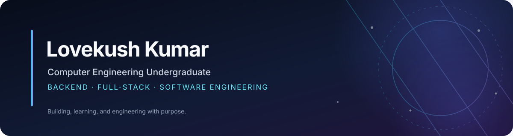

### Backend & Full-Stack Development · Machine Learning · Data Analytics

Building practical software, learning how systems work, and improving through deliberate engineering.

---

## About

I am pursuing a **B.Tech in Computer Engineering at KIET Deemed to be University (2024–2028)**. I enjoy designing and developing web applications, working with backend technologies, and solving programming problems.

My current technical interests are **backend engineering, API development, database design, data structures and algorithms, applied machine learning, and data analysis**. I value readable code, clear documentation, reproducible development workflows, and learning through building.

- **Education:** B.Tech, Computer Engineering — KIET Deemed to be University
- **Primary interests:** Backend systems, full-stack applications, software engineering
- **Currently improving:** Testing, code quality, system design fundamentals, and open-source collaboration

## Technical toolkit

| Area | Technologies |
|---|---|
| **Languages** | Python · C++ · Java · JavaScript · TypeScript |
| **Backend** | Node.js · Express.js · REST APIs |
| **Frontend** | React · Next.js · HTML · CSS · Tailwind CSS |
| **Databases** | MongoDB · Mongoose |
| **Tools & workflow** | Git · GitHub · ESLint · GitHub Actions |

## Featured projects

A selection of projects across software engineering, machine learning, and data analytics. Open a repository to explore its code, setup, and implementation details.

### Software engineering

| Project | What it demonstrates |
|---|---|
| [**HiTrack — Cricket Live Score**](https://github.com/L0VEKUSH/hitrack) | Cricket-focused web application; backend stack includes Node.js, Express, MongoDB, and Mongoose. |
| [**SpendPilot**](https://github.com/L0VEKUSH/spendpilot) | Personal-finance web application built with Next.js, React, TypeScript, and Tailwind CSS. |
| [**SHATVIKA**](https://github.com/L0VEKUSH/SHATVIKA) | Web application project using a modern JavaScript/TypeScript stack. |
| [**SYNC-KIET**](https://github.com/L0VEKUSH/SYNC-KIET) | Collaborative campus-focused project; see repository history for contribution context. |

### Machine learning & AI

| Project | What it demonstrates |
|---|---|
| [**Customer Churn Intelligence**](https://github.com/L0VEKUSH/Customer-Churn-Prediction) | Churn prediction workflow with EDA, preprocessing, Logistic Regression, Random Forest, XGBoost, evaluation metrics, and a Streamlit dashboard. |
| [**Handwritten Character Recognition**](https://github.com/L0VEKUSH/CodeAlpha_HandwrittenCharacterRecognition) | CNN-based A–Z character classification using EMNIST, TensorFlow/Keras, and Streamlit. The README reports 93.60% test accuracy on the EMNIST test set. |
| [**Animal Detector**](https://github.com/L0VEKUSH/AnimalDetector) | YOLO-based image, video, and webcam detection with a model-training pipeline and CSV/JSON detection logs. |
| [**Smart Attendance System**](https://github.com/L0VEKUSH/Smart-Attendance) | Face-recognition attendance workflow using LBPH and a CNN-based emotion model, with CSV/XLSX exports. |
| [**Credit Scoring Model**](https://github.com/L0VEKUSH/CodeAlpha_CreditScoringModel) | Classification project using Python and scikit-learn on the German Credit dataset. |
| [**Breast Cancer Classification API**](https://github.com/L0VEKUSH/CA2-GenAI) | Educational scikit-learn model served with FastAPI, with input validation, pytest tests, Docker, and GitHub Actions. Not intended for medical diagnosis. |

### Data analytics & business intelligence

| Project | What it demonstrates |
|---|---|
| [**Financial Health Dashboard — Power BI**](https://github.com/L0VEKUSH/Financial-Health-Dashboard-PowerBI) | Interactive financial KPI dashboard covering revenue, expenses, profitability, cash flow, and a six-month revenue forecast. |
| [**Sales Forecasting Intelligence**](https://github.com/L0VEKUSH/Codec_Sales_Forecasting) | Retail sales analysis and forecasting with time-based features, lag variables, Random Forest regression, and a Streamlit dashboard. |

## Current learning & engineering priorities

- Building maintainable backend services and reliable APIs
- Improving problem-solving skills through data structures and algorithms
- Writing meaningful unit and integration tests
- Using CI workflows to make project changes easier to verify
- Learning from established codebases and contributing constructively to open source

## Let's connect

I'm interested in **software engineering opportunities, technical collaboration, and meaningful projects** where I can learn, contribute, and grow.

- **Email:** [lovekushkumar4312@gmail.com](mailto:lovekushkumar4312@gmail.com)
- **LinkedIn:** [linkedin.com/in/lovekush-kumar-a0898533b](https://www.linkedin.com/in/lovekush-kumar-a0898533b/)
- **Instagram:** [@lovekush_4312](https://www.instagram.com/lovekush_4312/)
- **GitHub:** [github.com/L0VEKUSH](https://github.com/L0VEKUSH)

---

  Building with curiosity. Improving with consistency. Engineering with purpose.

